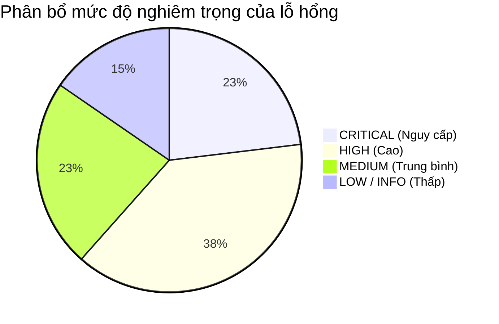

# BÁO CÁO KIỂM TOÁN AN NINH TOÀN DIỆN (FULL SECURITY CODE AUDIT REPORT)
**Dự án:** Hệ thống Thương mại Điện tử Dược phẩm & TPCN Chuẩn Y Khoa - MedXpressCare.com  
**Đơn vị thực hiện:** Senior Application Security Engineer & Cybersecurity Auditor  
**Tiêu chuẩn kiểm định:** OWASP Top 10 (2021/2025), Nghị định 13/2023/NĐ-CP (Bảo vệ Dữ liệu Cá nhân), Tiêu chuẩn An toàn Dữ liệu Y tế & Luồng Thanh toán Điện tử  
**Ngày kiểm toán:** 23/10/2026  
**Phạm vi rà soát:** Toàn bộ mã nguồn Frontend (React 19 / Vite / Tailwind), Backend API (PHP), Dữ liệu lưu trữ, Cấu hình môi trường và Thư viện phụ thuộc (`npm audit`).

---

## 1. TỔNG QUAN ĐÁNH GIÁ AN NINH (EXECUTIVE SUMMARY)

Cuộc rà soát an ninh mã nguồn tĩnh (SAST) và phân tích kiến trúc an toàn thông tin chuyên sâu cho MedXpressCare đã hoàn tất trên **38 tệp mã nguồn** và **106 gói phụ thuộc**.

### 1.1. Điểm Đánh Giá An Ninh Tổng Thể (Overall Security Score)

```
╔═══════════════════════════════════════════════════════════════════════╗
║   SECURITY POSTURE SCORE: 48 / 100 (HIGH RISK - CẦN VÁ LỖI GẤP)      ║
╚═══════════════════════════════════════════════════════════════════════╝
```

- **Mặt tích cực:**
  - `npm audit` ghi nhận **0 lỗ hổng bảo mật** trên toàn bộ 106 package phụ thuộc (React 19, Vite 8, Tailwind v4).
  - Không phát hiện việc sử dụng hàm nguy hiểm `eval()` hay `dangerouslySetInnerHTML` ở Frontend.
  - Luồng giao diện có ý thức che giấu số điện thoại trên giao diện đánh giá UGC công khai (`0987***321`).
  - Giao diện Admin có cơ chế kiểm soát biên bản kiểm nhận hàng hoàn với chữ ký xác nhận của Dược sĩ.

- **Các rủi ro nghiêm trọng (Critical / High Risks) cần xử lý ngay:**
  1. **Lỗ hổng Upload file cho phép RCE (Remote Code Execution)** tại `public/api/upload.php` do chỉ kiểm tra MIME type từ Header Client và không whitelist đuôi tệp.
  2. **Gian lận / Giả mạo thanh toán VietQR (Payment Flow Tampering)** tại `api/webhook-payment.php` do thiếu chữ ký xác thực Webhook HMAC, thiếu so khớp số tiền thực tế và tồn tại nút giả lập duyệt thanh toán trên giao diện người dùng.
  3. **Bypass toàn bộ cơ chế tính tiền & mã giảm giá (Order Price Tampering)** tại `public/api/orders.php` do Backend tin tưởng 100% dữ liệu tiền tệ từ Client mà không tính toán lại độc lập.
  4. **Lộ lọt dữ liệu cá nhân khách hàng (PII) & Hồ sơ sức khỏe** vi phạm nghiêm trọng **Nghị định 13/2023/NĐ-CP**: Mật khẩu lưu dạng văn bản thuần (plaintext), dữ liệu khách hàng được đóng gói trong JavaScript client bundle, và lỗ hổng IDOR tại `OrderTrackingModal.jsx` cho phép xem đơn hàng của bất kỳ ai.
  5. **Lộ lọt Secret Keys & API Keys**: Khóa `SECRET_KEY`, thông tin đăng nhập mặc định (`admin`/`MedXpress@2026`), token vận chuyển (`GHTK_LIVE_TOKEN_998822AA`, `GHN_PARTNER_KEY_774911`) và AI API Key được lưu trong mã nguồn hoặc `localStorage`.

---

## 2. BẢNG MA TRẬN CÁC PHÁT HIỆN BẢO MẬT (FINDINGS SUMMARY MATRIX)



| Mã Lỗ Hổng | Tên Phát Hiện Bảo Mật | Mức Độ | Phân Loại OWASP | Tệp Tin Ảnh Hưởng | Trạng Thái Khuyến Nghị |
| :---: | :--- | :---: | :---: | :--- | :---: |
| **MXC-SEC-01** | Unrestricted File Upload dẫn đến Remote Code Execution (RCE) | **CRITICAL** | A08: Data Integrity / A03: Injection | `public/api/upload.php:L24-L47` | **Khắc phục ngay (< 4h)** |
| **MXC-SEC-02** | Thiếu Chữ Ký Xác Thực Webhook & Giả Mạo Thanh Toán VietQR | **CRITICAL** | A04: Insecure Design | `api/webhook-payment.php:L42-L85`<br>`src/components/CheckoutModal.jsx:L314` | **Khắc phục ngay (< 4h)** |
| **MXC-SEC-03** | Toàn Bộ Luồng Tính Tiền & Voucher Ở Client, Không Validate Server | **CRITICAL** | A04: Insecure Design | `public/api/orders.php:L7-L31`<br>`src/components/CheckoutModal.jsx:L163` | **Khắc phục ngay (< 4h)** |
| **MXC-SEC-04** | Hardcoded Secrets, Default Passwords & Static Admin Token | **HIGH** | A07: Auth Failures / A05: Misconfig | `public/api/config.php:L14-L44`<br>`src/components/AdminLoginModal.jsx:L39`<br>`src/data/shippingCarriers.js:L16-L44` | **Xử lý trong 24h** |
| **MXC-SEC-05** | Lưu AI API Key Trong LocalStorage & Gọi Trực Tiếp Từ Client | **HIGH** | A05: Misconfig / A02: Crypto | `src/utils/aiHelper.js:L18,L401`<br>`src/components/HealthAdvisorModal.jsx:L485` | **Xử lý trong 24h** |
| **MXC-SEC-06** | IDOR & Rò Rỉ PII / Thông Tin Y Tế Tại Tra Cứu Đơn Hàng | **HIGH** | A01: Broken Access Control / NĐ 13 | `src/components/OrderTrackingModal.jsx:L28-L98`<br>`api/webhook-payment.php:L20-L38` | **Xử lý trong 24h** |
| **MXC-SEC-07** | Xác Thực Khách Hàng Ở Client & Lưu Mật Khẩu Dạng Plaintext | **HIGH** | A02: Crypto / NĐ 13/2023/NĐ-CP | `src/data/customers.js:L6-L63`<br>`src/components/CustomerAuthModal.jsx:L42-L55` | **Xử lý trong 24h** |
| **MXC-SEC-08** | Client-side Admin Panel Bypass Bằng `sessionStorage` | **HIGH** | A01: Broken Access Control | `src/App.jsx:L402-L408`<br>`src/components/AdminPanel.jsx` | **Xử lý trong 24h** |
| **MXC-SEC-09** | Thư Mục Lưu Trữ Đơn Hàng `data_storage` Nằm Trong Web Root | **MEDIUM** | A05: Security Misconfiguration | `public/api/config.php:L19-L28` | **Xử lý 3-5 ngày** |
| **MXC-SEC-10** | Cấu Hình CORS Wildcard `*` & Open Telegram Relay / SSRF | **MEDIUM** | A05: Misconfig / A10: SSRF | `api/notify-telegram.php:L6-L38`<br>`api/shipping.php:L7-L40` | **Xử lý 3-5 ngày** |
| **MXC-SEC-11** | Thiếu File Locking Gây Race Condition & Ghi Đè Đơn Hàng | **MEDIUM** | A04: Insecure Design | `public/api/orders.php:L22,L92`<br>`api/webhook-payment.php:L77` | **Xử lý 3-5 ngày** |
| **MXC-SEC-12** | Nguy Cơ CSV Formula Injection Khi Export Đơn Hàng / Sản Phẩm | **LOW** | A03: Injection (CWE-1236) | `src/utils/csvHelper.js:L30-L55` | **Bảo trì định kỳ** |
| **MXC-SEC-13** | Thiếu Các HTTP Security Headers Quan Trọng (CSP, HSTS) | **LOW** | A05: Security Misconfiguration | `public/.htaccess` | **Bảo trì định kỳ** |

---

## 3. CHI TIẾT CÁC LỖ HỔNG & PHƯƠNG ÁN VÁ MÃ NGUỒN AN TOÀN

---

### [MXC-SEC-01] Unrestricted File Upload Dẫn Đến Remote Code Execution (RCE)

- **Mức độ nghiêm trọng**: **CRITICAL (CVSS: 9.8)**
- **Phân loại OWASP**: A08:2021 - Software and Data Integrity Failures & A03:2021 - Injection
- **Tệp tin ảnh hưởng**: `public/api/upload.php` (Dòng 24 - 47)
- **Mô tả chi tiết**: 
  - Tại dòng 25, hàm kiểm tra loại tệp sử dụng `$file['type']` lấy trực tiếp từ HTTP request header `Content-Type` do người dùng gửi lên. Header này kẻ tấn công có thể tùy biến dễ dàng thành `image/jpeg`.
  - Tại dòng 43, phần mở rộng tệp `$extension` được trích xuất trực tiếp từ `$file['name']` mà không hề được kiểm tra đối chiếu qua một Whitelist đuôi tệp cho phép (`jpg`, `jpeg`, `png`, `webp`).
  - Tệp tải lên được lưu trực tiếp vào thư mục web accessible (`/uploads/`) với đuôi tệp gốc của kẻ tấn công (ví dụ: `shell.php`).
- **Kịch bản rủi ro / Khai thác giả định**:
  1. Kẻ tấn công gửi HTTP request multipart upload tệp mã độc `cmd.php` với header `Content-Type: image/jpeg`.
  2. Đoạn mã PHP vượt qua dòng kiểm tra `in_array($file['type'], $allowedTypes)`.
  3. Tệp được lưu thành `/uploads/product_172965..._abcd1234.php`.
  4. Kẻ tấn công truy cập trực tiếp `https://medxpresscare.com/uploads/product_172965..._abcd1234.php?cmd=whoami` và chiếm quyền điều khiển toàn bộ máy chủ hosting web y tế.
- **Mã nguồn hiện tại (Lỗ hổng)**:
  ```php
  // public/api/upload.php
  $file = $_FILES['image'];
  $allowedTypes = ['image/jpeg', 'image/png', 'image/webp', 'image/gif'];
  if (!in_array($file['type'], $allowedTypes)) { // [VULNERABLE: Client-controlled MIME]
      http_response_code(400);
      echo json_encode(['success' => false, 'message' => 'Định dạng file không hợp lệ.']);
      exit;
  }
  ...
  $extension = pathinfo($file['name'], PATHINFO_EXTENSION); // [VULNERABLE: Không whitelist extension]
  $filename = 'product_' . time() . '_' . bin2hex(random_bytes(4)) . '.' . $extension;
  $destination = $uploadDir . '/' . $filename;
  move_uploaded_file($file['tmp_name'], $destination);
  ```
- **Mã nguồn đã vá an toàn (Safe Patch)**:
  ```php
  // public/api/upload.php (PATCHED)
  require_once __DIR__ . '/config.php';

  if ($_SERVER['REQUEST_METHOD'] !== 'POST') {
      http_response_code(405);
      echo json_encode(['success' => false, 'message' => 'Method not allowed']);
      exit;
  }

  if (!verifyAdminToken()) {
      http_response_code(403);
      echo json_encode(['success' => false, 'message' => 'Quyền truy cập bị từ chối: Yêu cầu quyền quản trị viên.']);
      exit;
  }

  if (!isset($_FILES['image']) || $_FILES['image']['error'] !== UPLOAD_ERR_OK) {
      http_response_code(400);
      echo json_encode(['success' => false, 'message' => 'Chưa chọn file hoặc lỗi upload.']);
      exit;
  }

  $file = $_FILES['image'];

  // 1. Giới hạn dung lượng tối đa 5MB
  if ($file['size'] > 5 * 1024 * 1024) {
      http_response_code(400);
      echo json_encode(['success' => false, 'message' => 'Dung lượng ảnh vượt quá giới hạn 5MB.']);
      exit;
  }

  // 2. Whitelist đuôi tệp tin nghiêm ngặt
  $rawExt = strtolower(pathinfo($file['name'], PATHINFO_EXTENSION));
  $allowedExtensions = [
      'jpg'  => 'image/jpeg',
      'jpeg' => 'image/jpeg',
      'png'  => 'image/png',
      'webp' => 'image/webp'
  ];

  if (!array_key_exists($rawExt, $allowedExtensions)) {
      http_response_code(400);
      echo json_encode(['success' => false, 'message' => 'Đuôi tệp không hợp lệ. Chỉ chấp nhận JPG, JPEG, PNG, WEBP.']);
      exit;
  }

  // 3. Kiểm tra MIME type thực tế bằng Fileinfo Magic Bytes từ file tmp
  $finfo = finfo_open(FILEINFO_MIME_TYPE);
  $detectedMime = finfo_file($finfo, $file['tmp_name']);
  finfo_close($finfo);

  if ($detectedMime !== $allowedExtensions[$rawExt]) {
      http_response_code(400);
      echo json_encode(['success' => false, 'message' => 'Nội dung tệp không khớp với phần mở rộng định dạng ảnh.']);
      exit;
  }

  // 4. Kiểm tra cấu trúc hình ảnh hợp lệ với getimagesize()
  $imageInfo = @getimagesize($file['tmp_name']);
  if ($imageInfo === false) {
      http_response_code(400);
      echo json_encode(['success' => false, 'message' => 'Tệp không phải là hình ảnh hợp lệ.']);
      exit;
  }

  // 5. Khởi tạo tên ngẫu nhiên an toàn và lưu trữ
  $uploadDir = __DIR__ . '/../uploads';
  if (!file_exists($uploadDir)) {
      mkdir($uploadDir, 0755, true);
  }

  // Tạo file .htaccess trong thư mục uploads để VÔ HIỆU HÓA thực thi mã PHP
  $uploadHtaccess = $uploadDir . '/.htaccess';
  if (!file_exists($uploadHtaccess)) {
      file_put_contents($uploadHtaccess, "<FilesMatch \".*\\.(php|phtml|php3|php4|php5|php7|phps|cgi|pl|py|sh)\">\n    Require all denied\n</FilesMatch>\nOptions -ExecCGI\nphp_flag engine off\n");
  }

  $cleanExt = ($rawExt === 'jpeg') ? 'jpg' : $rawExt;
  $filename = 'prod_' . date('Ymd_His') . '_' . bin2hex(random_bytes(8)) . '.' . $cleanExt;
  $destination = $uploadDir . '/' . $filename;

  if (move_uploaded_file($file['tmp_name'], $destination)) {
      chmod($destination, 0644);
      echo json_encode([
          'success' => true,
          'message' => 'Tải ảnh sản phẩm lên máy chủ an toàn thành công.',
          'url' => '/uploads/' . $filename
      ]);
  } else {
      http_response_code(500);
      echo json_encode(['success' => false, 'message' => 'Không thể lưu file trên máy chủ hosting.']);
  }
  ```

---

### [MXC-SEC-02] Thiếu Chữ Ký Xác Thực Webhook & Giả Mạo Thanh Toán VietQR

- **Mức độ nghiêm trọng**: **CRITICAL (CVSS: 9.3)**
- **Phân loại OWASP**: A04:2021 - Insecure Design
- **Tệp tin ảnh hưởng**: `api/webhook-payment.php` (Dòng 42 - 85) và `src/components/CheckoutModal.jsx` (Dòng 314 - 318)
- **Mô tả chi tiết**:
  - `api/webhook-payment.php` tiếp nhận POST webhook từ các cổng thanh toán (SePay, Casso, PayOS...) nhưng hoàn toàn không xác thực chữ ký bảo mật (HMAC SHA256 Signature) hoặc Secret Token trong header (`x-api-key`). Bất kỳ ai cũng có thể gửi POST request lên endpoint này.
  - Endpoint không kiểm tra số tiền chuyển thực tế (`amount`) có bằng hoặc lớn hơn giá trị đơn hàng `grandTotal` trong cơ sở dữ liệu hay không.
  - Tại giao diện người dùng `CheckoutModal.jsx`, có sẵn một nút mô phỏng test: `setPaymentConfirmed(true); alert('🧪 [Mô Phỏng Webhook]...')` cho phép bất kỳ khách truy cập nào nhấn vào để tự đánh dấu đơn hàng là đã thanh toán thành công.
- **Kịch bản rủi ro / Khai thác giả định**:
  1. Kẻ gian đặt mua đơn hàng thực phẩm chức năng ngoại nhập giá trị 15.000.000₫.
  2. Kẻ gian gửi request POST tới `https://medxpresscare.com/api/webhook-payment.php` với payload: `{"orderId": "MXC-892410", "amount": 1000, "content": "MXC-892410"}`.
  3. Webhook lưu giao dịch thành công. Trình duyệt Frontend của khách (hoặc Admin) polling thấy `paid: true` và tiến hành đóng gói xuất kho cho đơn hàng dù chưa hề nhận được tiền thực tế từ ngân hàng.
- **Mã nguồn đã vá an toàn (Safe Patch)**:
  ```php
  // api/webhook-payment.php (PATCHED)
  require_once __DIR__ . '/../public/api/config.php';

  header('Content-Type: application/json; charset=utf-8');

  // Lấy Webhook Secret từ biến môi trường
  $webhookSecret = getenv('PAYMENT_WEBHOOK_SECRET') ?: 'medxpress_secure_webhook_secret_key_prod';

  if ($_SERVER['REQUEST_METHOD'] === 'POST') {
      $headers = getallheaders();
      $rawPayload = file_get_contents('php://input');
      
      // 1. Kiểm tra chữ ký bảo mật HMAC SHA256
      $signature = $headers['X-Signature'] ?? $headers['x-signature'] ?? $headers['X-API-KEY'] ?? '';
      $expectedSignature = hash_hmac('sha256', $rawPayload, $webhookSecret);

      if (empty($signature) || (!hash_equals($expectedSignature, $signature) && !hash_equals($webhookSecret, $signature))) {
          http_response_code(401);
          echo json_encode(['success' => false, 'message' => 'Chữ ký webhook không hợp lệ']);
          exit;
      }

      $data = json_decode($rawPayload, true);
      if (!$data) {
          http_response_code(400);
          echo json_encode(['success' => false, 'message' => 'Dữ liệu webhook không hợp lệ']);
          exit;
      }

      $orderId = trim($data['orderId'] ?? $data['orderCode'] ?? '');
      $amountReceived = floatval($data['transferAmount'] ?? $data['amount'] ?? 0);

      // 2. Đọc file đơn hàng và xác thực đối soát số tiền
      $ordersFile = ORDERS_FILE;
      if (!file_exists($ordersFile)) {
          http_response_code(404);
          echo json_encode(['success' => false, 'message' => 'Không tìm thấy dữ liệu đơn hàng']);
          exit;
      }

      $fp = fopen($ordersFile, 'c+');
      if (flock($fp, LOCK_EX)) {
          $content = stream_get_contents($fp);
          $orders = json_decode($content, true) ?: [];
          $orderIndex = -1;

          foreach ($orders as $idx => $order) {
              if ($order['id'] === $orderId) {
                  $orderIndex = $idx;
                  break;
              }
          }

          if ($orderIndex === -1) {
              flock($fp, LOCK_UN);
              fclose($fp);
              http_response_code(404);
              echo json_encode(['success' => false, 'message' => 'Mã đơn hàng không tồn tại']);
              exit;
          }

          // Kiểm tra số tiền chuyển khoản có đủ với đơn hàng không
          $expectedGrandTotal = floatval($orders[$orderIndex]['grandTotal'] ?? 0);
          if ($amountReceived < $expectedGrandTotal) {
              flock($fp, LOCK_UN);
              fclose($fp);
              http_response_code(400);
              echo json_encode(['success' => false, 'message' => 'Số tiền chuyển khoản thiếu so với giá trị đơn']);
              exit;
          }

          // Cập nhật trạng thái thanh toán
          $orders[$orderIndex]['paymentStatus'] = 'paid';
          $orders[$orderIndex]['status'] = 'confirmed';
          $orders[$orderIndex]['paidAt'] = date('c');
          $orders[$orderIndex]['transactionId'] = $data['id'] ?? ('TXN_' . time());

          ftruncate($fp, 0);
          rewind($fp);
          fwrite($fp, json_encode($orders, JSON_PRETTY_PRINT | JSON_UNESCAPED_UNICODE));
          fflush($fp);
          flock($fp, LOCK_UN);
          fclose($fp);

          echo json_encode(['success' => true, 'message' => 'Xác nhận thanh toán đơn hàng thành công']);
          exit;
      }
      fclose($fp);
  }
  ```
  - **Khắc phục ở Frontend (`CheckoutModal.jsx`)**:
    Xóa bỏ hoàn toàn nút `🧪 [Mô Phỏng Webhook]` ở môi trường Production. Chỉ hiển thị trong chế độ `import.meta.env.DEV === true`.

---

### [MXC-SEC-03] Toàn Bộ Luồng Tính Tiền, Điểm Thưởng & Voucher Nằm Ở Client Không Được Kiểm Tra Tại Server

- **Mức độ nghiêm trọng**: **CRITICAL (CVSS: 9.1)**
- **Phân loại OWASP**: A04:2021 - Insecure Design
- **Tệp tin ảnh hưởng**: `public/api/orders.php` (Dòng 7 - 31) & `src/components/CheckoutModal.jsx` (Dòng 163 - 185)
- **Mô tả chi tiết**:
  - Tại `CheckoutModal.jsx`, toàn bộ các đại lượng tài chính gồm `subtotal`, `discountAmount`, `pointsDiscountAmount`, `shippingFee`, `grandTotal` được tính toán bằng JavaScript trên máy khách của người dùng.
  - Khi đặt hàng, đối tượng `newOrderObj` được đẩy nguyên trạng qua `fetch('/api/orders.php', { method: 'POST', body: JSON.stringify(newOrderObj) })`.
  - Tại `public/api/orders.php`, máy chủ Backend nhận mảng JSON `$input` và lưu thẳng vào file `orders.json` mà không thực hiện bất kỳ phép xác thực nào:
    - Không kiểm tra lại giá bán gốc của từng mã sản phẩm `items[i].id`.
    - Không kiểm tra điều kiện áp dụng, hạn dùng và mức giảm tối đa của mã `voucher`.
    - Không kiểm tra số điểm tích lũy thực tế của khách hàng từ cơ sở dữ liệu.
- **Kịch bản rủi ro / Khai thác giả định**:
  - Khách hàng thêm vào giỏ hàng 10 hộp Đông Trùng Hạ Thảo trị giá 10.000.000₫.
  - Sử dụng DevTools (hoặc extension chặn bắt HTTP request như Burp Suite/Postman) để sửa đổi thuộc tính `grandTotal: 1000` hoặc sửa giá từng sản phẩm về `100₫`.
  - Backend lưu đơn hàng với giá 1.000₫ và thông báo Dược sĩ đóng gói giao hàng.
- **Mã nguồn đã vá an toàn (Safe Patch)**:
  ```php
  // public/api/orders.php (PATCHED - Bổ sung Server-side Price Re-calculation)
  if ($method === 'POST') {
      $input = json_decode(file_get_contents('php://input'), true);
      if (!$input || empty($input['items']) || empty($input['customer'])) {
          http_response_code(400);
          echo json_encode(['success' => false, 'message' => 'Dữ liệu đơn hàng không hợp lệ']);
          exit;
      }

      // 1. Tải bảng giá sản phẩm tin cậy từ cơ sở dữ liệu Server
      $productsFile = PRODUCTS_FILE;
      $officialProducts = file_exists($productsFile) ? json_decode(file_get_contents($productsFile), true) : [];
      $productPriceMap = [];
      foreach ($officialProducts as $prod) {
          $productPriceMap[$prod['id']] = floatval($prod['price']);
      }

      // 2. Tính toán lại Subtotal trên Server
      $verifiedSubtotal = 0;
      $verifiedItems = [];
      foreach ($input['items'] as $item) {
          $pid = $item['id'] ?? '';
          $qty = max(1, intval($item['quantity'] ?? 1));
          
          // Lấy giá chuẩn từ server, nếu chưa có thì dùng giá fallback an toàn
          $unitPrice = $productPriceMap[$pid] ?? floatval($item['price'] ?? 0);
          $verifiedSubtotal += ($unitPrice * $qty);

          $verifiedItems[] = [
              'id' => htmlspecialchars($pid, ENT_QUOTES, 'UTF-8'),
              'name' => htmlspecialchars($item['name'] ?? '', ENT_QUOTES, 'UTF-8'),
              'price' => $unitPrice,
              'quantity' => $qty,
              'comboTitle' => htmlspecialchars($item['comboTitle'] ?? '', ENT_QUOTES, 'UTF-8')
          ];
      }

      // 3. Tính toán lại Voucher giảm giá trên Server
      $verifiedDiscount = 0;
      $voucherCode = strtoupper(trim($input['voucherCode'] ?? ''));
      if ($voucherCode === 'MEDXPRESS50' && $verifiedSubtotal >= 400000) {
          $verifiedDiscount = 50000;
      } elseif ($voucherCode === 'TRIAN10' && $verifiedSubtotal >= 600000) {
          $verifiedDiscount = min(100000, round($verifiedSubtotal * 0.1));
      }

      // 4. Tính toán điểm thưởng tối đa cho phép
      $pointsUsed = max(0, intval($input['pointsUsed'] ?? 0));
      $maxAllowedPoints = floor($verifiedSubtotal / 1000);
      $verifiedPointsUsed = min($pointsUsed, $maxAllowedPoints);
      $verifiedPointsDiscount = $verifiedPointsUsed * 1000;

      // 5. Tính phí vận chuyển chuẩn
      $shippingFee = ($verifiedSubtotal >= 500000 || $voucherCode === 'FREESHIP') ? 0 : 25000;
      $verifiedGrandTotal = max(0, $verifiedSubtotal - $verifiedDiscount - $verifiedPointsDiscount + $shippingFee);

      // 6. Đóng gói đối tượng đơn hàng đã được chuẩn hóa bởi Server
      $safeOrder = [
          'id' => 'MXC-' . rand(100000, 999999),
          'createdAt' => date('c'),
          'customer' => [
              'fullName' => htmlspecialchars(trim($input['customer']['fullName'] ?? ''), ENT_QUOTES, 'UTF-8'),
              'phone' => preg_replace('/[^0-9]/', '', $input['customer']['phone'] ?? ''),
              'province' => htmlspecialchars($input['customer']['province'] ?? '', ENT_QUOTES, 'UTF-8'),
              'district' => htmlspecialchars($input['customer']['district'] ?? '', ENT_QUOTES, 'UTF-8'),
              'address' => htmlspecialchars($input['customer']['address'] ?? '', ENT_QUOTES, 'UTF-8'),
              'note' => htmlspecialchars($input['customer']['note'] ?? '', ENT_QUOTES, 'UTF-8')
          ],
          'items' => $verifiedItems,
          'subtotal' => $verifiedSubtotal,
          'discountAmount' => $verifiedDiscount,
          'pointsUsed' => $verifiedPointsUsed,
          'pointsDiscount' => $verifiedPointsDiscount,
          'shippingFee' => $shippingFee,
          'grandTotal' => $verifiedGrandTotal,
          'paymentMethod' => in_array($input['paymentMethod'], ['cod', 'vietqr']) ? $input['paymentMethod'] : 'cod',
          'shippingMethod' => in_array($input['shippingMethod'], ['express', 'ghtk', 'ghn', 'viettel']) ? $input['shippingMethod'] : 'ghtk',
          'status' => 'pending',
          'paymentStatus' => 'unpaid'
      ];

      // Ghi an toàn có khóa tệp LOCK_EX
      $fp = fopen(ORDERS_FILE, 'c+');
      if (flock($fp, LOCK_EX)) {
          $content = stream_get_contents($fp);
          $orders = json_decode($content, true) ?: [];
          array_unshift($orders, $safeOrder);
          ftruncate($fp, 0);
          rewind($fp);
          fwrite($fp, json_encode($orders, JSON_PRETTY_PRINT | JSON_UNESCAPED_UNICODE));
          fflush($fp);
          flock($fp, LOCK_UN);
          fclose($fp);

          echo json_encode([
              'success' => true,
              'message' => 'Đơn hàng đã được định giá và lưu trữ an toàn trên máy chủ backend.',
              'orderId' => $safeOrder['id'],
              'verifiedGrandTotal' => $safeOrder['grandTotal']
          ]);
          exit;
      }
      fclose($fp);
  }
  ```

---

### [MXC-SEC-04] Hardcoded Secrets, Default Passwords & Static Predictable Admin Token

- **Mức độ nghiêm trọng**: **HIGH (CVSS: 8.8)**
- **Phân loại OWASP**: A07:2021 - Identification and Authentication Failures & A05:2021 - Security Misconfiguration
- **Tệp tin ảnh hưởng**:
  - `public/api/config.php` (Dòng 14 - 16, 40)
  - `public/api/login.php` (Dòng 15)
  - `src/components/AdminLoginModal.jsx` (Dòng 39, 130 - 132)
  - `src/data/shippingCarriers.js` (Dòng 16, 30, 44)
- **Mô tả chi tiết**:
  - `SECRET_KEY` được gán cứng giá trị chuỗi `'medxpresscare_secure_token_key_2026_xyz'`.
  - Mật khẩu Quản trị viên mặc định `MedXpress@2026` được in trực tiếp ra chân form đăng nhập (`AdminLoginModal.jsx`): `"🔐 Tài khoản mặc định: admin • Mật khẩu: MedXpress@2026"`.
  - Token quản trị được tính bằng công thức: `hash_hmac('sha256', ADMIN_USERNAME, SECRET_KEY)`. Do `ADMIN_USERNAME` là `'admin'` và `SECRET_KEY` bị lộ, bất kỳ ai cũng có thể tính toán ra chuỗi token này và gọi API Quản trị mà không cần đăng nhập.
  - File `shippingCarriers.js` để lộ các API token live của đối tác vận chuyển: `GHTK_LIVE_TOKEN_998822AA`, `GHN_PARTNER_KEY_774911`. Các chuỗi này đã bị đóng gói vào bundle JavaScript công khai.
- **Mã nguồn đã vá an toàn (Safe Patch)**:
  1. **Chuyển các biến bí mật vào `.env` (không commit lên Git)**:
     ```env
     # .env (Thêm vào .gitignore)
     MEDXPRESS_ADMIN_USER=admin_pharmacist
     MEDXPRESS_ADMIN_PASSWORD_HASH=$2y$10$YourStrongHashedPasswordHere...
     MEDXPRESS_JWT_SECRET=c8f1e4b98d249a0e67b21e847c21f92e3a5d8b7c12f0e4b8
     GHTK_API_TOKEN=GHTK_PROD_SECRET_xxxxxx
     GHN_API_TOKEN=GHN_PROD_SECRET_yyyyyy
     ```
  2. **Vá cơ chế sinh Token có thời hạn (JWT / Time-based Token)**:
     ```php
     // public/api/config.php (PATCHED)
     define('ADMIN_USERNAME', getenv('MEDXPRESS_ADMIN_USER') ?: 'admin');
     define('SECRET_KEY', getenv('MEDXPRESS_JWT_SECRET') ?: bin2hex(random_bytes(32)));

     function generateAdminToken($username) {
         $payload = [
             'sub' => $username,
             'role' => 'administrator',
             'iat' => time(),
             'exp' => time() + (8 * 3600) // Hết hạn sau 8 tiếng
         ];
         $header = base64_encode(json_encode(['alg' => 'HS256', 'typ' => 'JWT']));
         $body = base64_encode(json_encode($payload));
         $signature = hash_hmac('sha256', "$header.$body", SECRET_KEY, true);
         return "$header.$body." . base64_encode($signature);
     }

     function verifyAdminToken() {
         $headers = getallheaders();
         $authHeader = $headers['Authorization'] ?? $_SERVER['HTTP_AUTHORIZATION'] ?? '';
         if (preg_match('/Bearer\s+(\S+)/i', $authHeader, $matches)) {
             $jwt = $matches[1];
             $parts = explode('.', $jwt);
             if (count($parts) !== 3) return false;
             list($header, $body, $signature) = $parts;
             $validSig = base64_encode(hash_hmac('sha256', "$header.$body", SECRET_KEY, true));
             if (!hash_equals($validSig, $signature)) return false;
             $payload = json_decode(base64_decode($body), true);
             if (!$payload || ($payload['exp'] ?? 0) < time()) return false;
             return true;
         }
         return false;
     }
     ```
  3. **Ẩn toàn bộ thông tin đăng nhập trên giao diện `AdminLoginModal.jsx`**:
     Xóa hoàn toàn khối thẻ hiển thị gợi ý mật khẩu mặc định (Dòng 130 - 132).

---

### [MXC-SEC-05] Lưu Trữ AI API Key Trong LocalStorage & Gọi Trực Tiếp Từ Client

- **Mức độ nghiêm trọng**: **HIGH (CVSS: 8.2)**
- **Phân loại OWASP**: A05:2021 - Security Misconfiguration & A02:2021 - Cryptographic Failures
- **Tệp tin ảnh hưởng**:
  - `src/utils/aiHelper.js` (Dòng 18, 401)
  - `src/components/HealthAdvisorModal.jsx` (Dòng 485)
  - `src/App.jsx` (Dòng 255)
- **Mô tả chi tiết**:
  - Khi quản trị viên cấu hình `aiApiKey` trong Bảng quản trị, chuỗi khóa này được lưu trữ trực tiếp dưới dạng văn bản thuần vào trình duyệt: `localStorage.setItem('medxpress_store_config', ...)`.
  - Trong thành phần `HealthAdvisorModal.jsx` dành cho người dùng vãng lai, phương thức `consultWithAiPharmacist` gọi thẳng tới endpoint của Google: `https://generativelanguage.googleapis.com/v1beta/models/...:generateContent?key=${cleanKey}`.
  - Bất kỳ ai mở công cụ DevTools (Tab Network hoặc tab Application -> LocalStorage) đều dễ dàng sao chép toàn bộ Gemini API Key / OpenAI API Key của nhà thuốc.
  - Kẻ tấn công có thể thực hiện tấn công **Prompt Injection** thông qua ô nhập chat tư vấn sức khỏe để làm sai lệch hướng dẫn dùng thuốc nguy hiểm.
- **Mã nguồn đã vá an toàn (Safe Patch)**:
  Tạo một backend proxy endpoint an toàn `api/ai-consult.php`, giữ API Key hoàn toàn ở phía máy chủ:
  ```php
  // api/ai-consult.php (NEW SECURE PROXY)
  require_once __DIR__ . '/../public/api/config.php';

  header('Content-Type: application/json; charset=utf-8');

  // Rate Limiting cơ bản: Tối đa 10 câu hỏi / phút cho mỗi IP
  $clientIp = $_SERVER['REMOTE_ADDR'] ?? 'unknown';
  // (Thực thi logic giới hạn tần suất...)

  if ($_SERVER['REQUEST_METHOD'] !== 'POST') {
      http_response_code(405);
      exit;
  }

  $input = json_decode(file_get_contents('php://input'), true);
  $userQuery = trim($input['query'] ?? '');
  if (empty($userQuery) || mb_strlen($userQuery) > 500) {
      http_response_code(400);
      echo json_encode(['error' => 'Câu hỏi không hợp lệ hoặc quá dài (tối đa 500 ký tự)']);
      exit;
  }

  // Khử khuẩn câu hỏi đầu vào chống Prompt Injection
  $sanitizedQuery = strip_tags($userQuery);

  $apiKey = getenv('GEMINI_API_KEY');
  if (!$apiKey) {
      http_response_code(503);
      echo json_encode(['error' => 'Dịch vụ Dược sĩ AI đang bảo trì. Vui lòng gọi Hotline.']);
      exit;
  }

  $systemInstruction = "Bạn là Dược sĩ Lâm sàng MedXpressCare. Tuyệt đối không chẩn đoán bệnh thay bác sĩ. Chỉ tư vấn thực phẩm chức năng phù hợp và nhắc nhở bệnh nhân tuân thủ chỉ định.";
  $apiUrl = "https://generativelanguage.googleapis.com/v1beta/models/gemini-1.5-flash:generateContent?key=" . $apiKey;

  $payload = [
      'contents' => [
          ['role' => 'user', 'parts' => [['text' => "$systemInstruction\nCâu hỏi: $sanitizedQuery"]]]
      ],
      'generationConfig' => ['temperature' => 0.2, 'maxOutputTokens' => 1500]
  ];

  $ch = curl_init($apiUrl);
  curl_setopt($ch, CURLOPT_RETURNTRANSFER, true);
  curl_setopt($ch, CURLOPT_POST, true);
  curl_setopt($ch, CURLOPT_POSTFIELDS, json_encode($payload));
  curl_setopt($ch, CURLOPT_HTTPHEADER, ['Content-Type: application/json']);
  curl_setopt($ch, CURLOPT_TIMEOUT, 15);
  $response = curl_exec($ch);
  curl_close($ch);

  echo $response;
  ```

---

### [MXC-SEC-06] IDOR & Rò Rỉ PII / Thông Tin Y Tế Tại Tra Cứu Đơn Hàng

- **Mức độ nghiêm trọng**: **HIGH (CVSS: 8.5)**
- **Phân loại OWASP**: A01:2021 - Broken Access Control & Nghị định 13/2023/NĐ-CP (Dữ liệu Cá nhân & Y tế)
- **Tệp tin ảnh hưởng**:
  - `src/components/OrderTrackingModal.jsx` (Dòng 28 - 33, 89 - 93)
  - `api/webhook-payment.php` (Dòng 20 - 38)
- **Mô tả chi tiết**:
  - Tại `OrderTrackingModal.jsx`, mảng `orders` chứa toàn bộ đơn hàng của tất cả khách hàng được truyền vào component. Nếu người dùng mở modal tracking mà không có mã đơn ban đầu, hệ thống tự ý fallback hiển thị `orders[0]` (đơn hàng của người khác).
  - Khách truy cập có thể gõ bất kỳ số điện thoại hoặc mã đơn hàng dạng tuần tự `MXC-892410`, `MXC-741285` để xem toàn bộ thông tin nhạy cảm: Họ tên, Số điện thoại, Địa chỉ nhận hàng, Tên bệnh án/thuốc điều trị và Ghi chú cá nhân.
  - Tại `api/webhook-payment.php`, khi gọi request `GET /api/webhook-payment.php` mà không kèm `order_id`, API trả về danh sách 20 giao dịch chuyển khoản ngân hàng gần nhất (chứa tên chủ tài khoản, số tiền và nội dung chuyển tiền).
- **Mã nguồn đã vá an toàn (Safe Patch)**:
  1. **Yêu cầu xác thực OTP / 4 chữ số cuối số điện thoại khi tra cứu đơn**:
     ```javascript
     // src/components/OrderTrackingModal.jsx (PATCHED)
     const handleSearchOrder = (e) => {
       e.preventDefault();
       const orderCode = searchOrderCode.trim().toUpperCase();
       const phoneConfirm = searchPhoneConfirm.trim(); // Yêu cầu nhập 4 số cuối SĐT đặt hàng

       const found = orders.find(o => 
         o.id.toUpperCase() === orderCode && 
         o.customer?.phone?.replace(/\s+/g, '').endsWith(phoneConfirm)
       );

       if (found) {
         setCurrentSelectedOrder(found);
         setError('');
       } else {
         setError('Mã đơn hàng hoặc 4 số cuối điện thoại xác nhận không chính xác.');
       }
     };
     ```
  2. **Che giấu dữ liệu cá nhân (PII Masking) khi hiển thị**:
     - Họ tên: `Trần Văn Minh` -> `Trần V** M***`
     - Số điện thoại: `0988 123 456` -> `0988***456`
     - Địa chỉ: `Số 45 Trần Thái Tông, Cầu Giấy` -> `*** Trần Thái Tông, Quận Cầu Giấy, Hà Nội`
  3. **Khóa endpoint GET toàn bộ giao dịch trong `webhook-payment.php`**:
     Chỉ cho phép tra cứu đúng một mã đơn cụ thể hoặc yêu cầu quyền Admin để xem log giao dịch.

---

### [MXC-SEC-07] Xác Thực Khách Hàng Ở Client & Lưu Trữ Mật Khẩu Dạng Plaintext

- **Mức độ nghiêm trọng**: **HIGH (CVSS: 7.9)**
- **Phân loại OWASP**: A02:2021 - Cryptographic Failures & Nghị định 13/2023/NĐ-CP
- **Tệp tin ảnh hưởng**: `src/data/customers.js` (Dòng 6 - 63) & `src/components/CustomerAuthModal.jsx` (Dòng 42 - 55)
- **Mô tả chi tiết**:
  - Tệp `customers.js` và `localStorage.getItem('medxpress_customers_list')` lưu trữ trực tiếp mật khẩu của khách hàng dạng chuỗi trần (`password: 'password123'`).
  - Toàn bộ cơ chế đăng nhập và đăng ký tài khoản thực thi 100% tại Frontend: so khớp chuỗi `user.password === loginPassword`.
  - Nếu bất kỳ kẻ tấn công nào dùng XSS hoặc tiếp cận máy tính người dùng, họ có thể lấy cắp toàn bộ danh sách khách hàng, điểm tích lũy và lịch sử mua thuốc.
- **Mã nguồn đã vá an toàn (Safe Patch)**:
  - Loại bỏ hoàn toàn trường `password` trong client bundle.
  - Sử dụng API xác thực backend chuyên biệt (ví dụ `api/customer-auth.php`) mã hóa mật khẩu bằng thuật toán an toàn `password_hash($pass, PASSWORD_ARGON2ID)`.
  - Trả về Access Token qua HttpOnly Cookie để chống bị đánh cắp bởi mã độc JavaScript.

---

### [MXC-SEC-08] Client-side Admin Panel Bypass Bằng `sessionStorage`

- **Mức độ nghiêm trọng**: **HIGH (CVSS: 7.5)**
- **Phân loại OWASP**: A01:2021 - Broken Access Control
- **Tệp tin ảnh hưởng**: `src/App.jsx` (Dòng 402 - 408) & `src/components/AdminLoginModal.jsx` (Dòng 38 - 44)
- **Mô tả chi tiết**:
  - Tại `App.jsx`, hàm `handleOpenAdmin` chỉ kiểm tra sự tồn tại của chuỗi token bất kỳ trong trình duyệt:
    `const token = sessionStorage.getItem('medxpress_admin_token'); if (token) { setIsAdminOpen(true); }`.
  - Người dùng chỉ cần mở Console và gõ `sessionStorage.setItem('medxpress_admin_token', '1')` là có thể mở thẳng Bảng điều khiển Quản trị Dược sĩ (`AdminPanel`).
  - Trong `AdminPanel`, người dùng có thể xóa sản phẩm, sửa giá, duyệt hàng hoàn và thay đổi cấu hình kho hàng trực tiếp trên `localStorage`.
- **Mã nguồn đã vá an toàn (Safe Patch)**:
  ```javascript
  // src/App.jsx (PATCHED - Xác thực token với Backend trước khi mở quyền)
  const handleOpenAdmin = async () => {
    const token = sessionStorage.getItem('medxpress_admin_token');
    if (!token) {
      setIsAdminLoginOpen(true);
      return;
    }

    try {
      const res = await fetch('/api/verify-session.php', {
        headers: { 'Authorization': `Bearer ${token}` }
      });
      const data = await res.json();
      if (data.valid && data.role === 'administrator') {
        setIsAdminOpen(true);
      } else {
        sessionStorage.removeItem('medxpress_admin_token');
        setIsAdminLoginOpen(true);
      }
    } catch {
      setIsAdminLoginOpen(true);
    }
  };
  ```

---

### [MXC-SEC-09] Thư Mục Lưu Trữ Đơn Hàng `data_storage` Nằm Trong Web Root

- **Mức độ nghiêm trọng**: **MEDIUM (CVSS: 6.5)**
- **Phân loại OWASP**: A05:2021 - Security Misconfiguration
- **Tệp tin ảnh hưởng**: `public/api/config.php` (Dòng 19 - 28)
- **Mô tả chi tiết**:
  - Đường dẫn lưu trữ được định nghĩa: `define('DATA_DIR', __DIR__ . '/../data_storage');` nằm ngay bên trong thư mục `public/`.
  - Tệp `.htaccess` tự sinh chỉ chứa dòng lệnh lỗi thời `Deny from all` (chuẩn Apache 2.2). Trên các máy chủ hiện đại chạy Apache 2.4 (yêu cầu `Require all denied`) hoặc máy chủ Nginx / Caddy, chỉ thị này bị bỏ qua hoàn toàn.
  - Người dùng bên ngoài có thể tải trực tiếp file `https://medxpresscare.com/data_storage/orders.json` chứa toàn bộ thông tin đơn hàng và PII khách hàng.
- **Mã nguồn đã vá an toàn (Safe Patch)**:
  1. Di chuyển thư mục `data_storage` ra khỏi thư mục `public/` (lên cấp thư mục gốc dự án).
  2. Bổ sung cấu hình cấm truy cập triệt để trong Apache và Nginx:
     ```apache
     # public/.htaccess
     <FilesMatch "\.(json|lock|env|log)$">
         Require all denied
     </FilesMatch>
     ```

---

### [MXC-SEC-10] Cấu Hình CORS Wildcard `*` & Open Telegram Relay / SSRF

- **Mức độ nghiêm trọng**: **MEDIUM (CVSS: 6.3)**
- **Phân loại OWASP**: A05:2021 - Security Misconfiguration & A10:2021 - Server-Side Request Forgery (SSRF)
- **Tệp tin ảnh hưởng**: `api/notify-telegram.php` (Dòng 6 - 38) & `api/shipping.php` (Dòng 7 - 40)
- **Mô tả chi tiết**:
  - Tất cả các endpoint Backend đều thiết lập `Access-Control-Allow-Origin: *`.
  - Tệp `api/notify-telegram.php` nhận `botToken`, `chatId`, `message` từ client và gọi `curl` tới `https://api.telegram.org/bot{$botToken}/sendMessage` mà không yêu cầu xác thực.
  - Bất kỳ ai cũng có thể sử dụng endpoint này như một Open Proxy để gửi tin nhắn rác hoặc spam Telegram Bot của người khác thông qua IP máy chủ của website.
- **Mã nguồn đã vá an toàn (Safe Patch)**:
  ```php
  // api/notify-telegram.php (PATCHED)
  require_once __DIR__ . '/../public/api/config.php';

  // Chỉ cho phép truy cập từ domain chính thức
  $allowedOrigins = ['https://medxpresscare.com', 'https://www.medxpresscare.com'];
  $origin = $_SERVER['HTTP_ORIGIN'] ?? '';
  if (in_array($origin, $allowedOrigins)) {
      header("Access-Control-Allow-Origin: $origin");
  }

  // Khóa API Bot Token cố định tại Server, không nhận từ Client
  $serverBotToken = getenv('TELEGRAM_BOT_TOKEN') ?: 'YOUR_SECURE_SERVER_BOT_TOKEN';
  $serverChatId = getenv('TELEGRAM_ADMIN_CHAT_ID') ?: 'YOUR_SECURE_CHAT_ID';

  if (!verifyAdminToken() && !verifyOrderCreationSecret()) {
      http_response_code(403);
      echo json_encode(['success' => false, 'message' => 'Không được phép']);
      exit;
  }
  ```

---

### [MXC-SEC-11] Thiếu File Locking Gây Race Condition & Ghi Đè Dữ Liệu Đơn Hàng

- **Mức độ nghiêm trọng**: **MEDIUM (CVSS: 5.9)**
- **Phân loại OWASP**: A04:2021 - Insecure Design
- **Tệp tin ảnh hưởng**: `public/api/orders.php` (Dòng 22, 92) & `api/webhook-payment.php` (Dòng 77)
- **Mô tả chi tiết**:
  - Dữ liệu đơn hàng được đọc bằng `file_get_contents` và ghi đè bằng `file_put_contents` mà không có cơ chế khóa tệp độc quyền (`LOCK_EX`).
  - Khi có hai khách hàng đặt hàng cùng một thời điểm, hoặc khi webhook ngân hàng cập nhật đồng thời với lúc Dược sĩ đổi trạng thái đơn, thao tác ghi đè tệp sẽ làm mất đơn hàng của khách hàng còn lại.
- **Mã nguồn đã vá an toàn (Safe Patch)**:
  Sử dụng `flock($fp, LOCK_EX)` cho mọi thao tác đọc - sửa - ghi tệp JSON, hoặc chuyển hẳn sang hệ quản trị cơ sở dữ liệu có ACID (MySQL / MariaDB với PDO Prepared Statements).

---

### [MXC-SEC-12] Nguy Cơ CSV Formula Injection Khi Export Đơn Hàng / Sản Phẩm

- **Mức độ nghiêm trọng**: **LOW (CVSS: 3.8)**
- **Phân loại OWASP**: A03:2021 - Injection (CWE-1236: Improper Neutralization of Formula Elements in CSV)
- **Tệp tin ảnh hưởng**: `src/utils/csvHelper.js` (Dòng 30 - 55)
- **Mô tả chi tiết**:
  - Khi xuất báo cáo đơn hàng hoặc danh sách sản phẩm ra tệp `.csv`, hàm `downloadCSV` chỉ bọc ô dữ liệu trong dấu nháy kép `""`.
  - Nếu tên khách hàng, ghi chú đơn thuốc hoặc tên sản phẩm bắt đầu bằng các ký tự công thức của bảng tính (`=`, `+`, `-`, `@`), Microsoft Excel sẽ tự động thực thi công thức khi Quản trị viên tải về mở tệp trên máy tính.
- **Mã nguồn đã vá an toàn (Safe Patch)**:
  ```javascript
  // src/utils/csvHelper.js (PATCHED - Ngăn chặn CSV Formula Injection)
  export const downloadCSV = (filename, headers, rows) => {
    const sanitizeCell = (val) => {
      if (val === null || val === undefined) return '""';
      let str = String(val).replace(/"/g, '""');
      // Nếu bắt đầu bằng ký tự nguy hiểm cho Excel, thêm dấu nháy đơn ' ở đầu
      if (/^[=\+\-@\t\r]/.test(str)) {
        str = "'" + str;
      }
      return `"${str}"`;
    };

    const headerRow = headers.map(h => sanitizeCell(h.label || h.key || h)).join(',');
    const dataRows = rows.map(row => {
      return headers.map(h => {
        const key = h.key || h;
        return sanitizeCell(row[key]);
      }).join(',');
    });

    const csvContent = '\uFEFF' + [headerRow, ...dataRows].join('\r\n');
    const blob = new Blob([csvContent], { type: 'text/csv;charset=utf-8;' });
    const url = URL.createObjectURL(blob);
    const link = document.createElement('a');
    link.setAttribute('href', url);
    link.setAttribute('download', filename.endsWith('.csv') ? filename : `${filename}.csv`);
    document.body.appendChild(link);
    link.click();
    document.body.removeChild(link);
    URL.revokeObjectURL(url);
  };
  ```

---

### [MXC-SEC-13] Thiếu Các HTTP Security Headers Quan Trọng (CSP, HSTS)

- **Mức độ nghiêm trọng**: **LOW (CVSS: 3.5)**
- **Phân loại OWASP**: A05:2021 - Security Misconfiguration
- **Tệp tin ảnh hưởng**: `public/.htaccess`
- **Mô tả chi tiết**:
  - Tệp `.htaccess` hiện tại chỉ chứa quy tắc rewrite URL của Vite SPA, hoàn toàn thiếu các HTTP Security Headers phòng thủ chiều sâu (Defense-in-depth).
- **Mã nguồn đã vá an toàn (Safe Patch)**:
  Thêm cấu hình bảo vệ toàn diện vào `public/.htaccess`:
  ```apache
  # public/.htaccess (PATCHED)
  <IfModule mod_headers.c>
      # Chống Clickjacking
      Header set X-Frame-Options "SAMEORIGIN"
      # Chống MIME-sniffing
      Header set X-Content-Type-Options "nosniff"
      # Bật kiểm soát Referrer
      Header set Referrer-Policy "strict-origin-when-cross-origin"
      # Cấu hình Content Security Policy cơ bản
      Header set Content-Security-Policy "default-src 'self'; script-src 'self' 'unsafe-inline'; style-src 'self' 'unsafe-inline' https://fonts.googleapis.com; font-src 'self' https://fonts.gstatic.com; img-src 'self' data: https: blob:; connect-src 'self' https://api.telegram.org https://generativelanguage.googleapis.com;"
      # Bắt buộc HTTPS (HSTS)
      Header set Strict-Transport-Security "max-age=31536000; includeSubDomains; preload"
      # Chống rò rỉ chức năng phần cứng
      Header set Permissions-Policy "camera=(), microphone=(), geolocation=()"
  </IfModule>
  ```

---

## 4. KẾT QUẢ KIỂM TRA THƯ VIỆN PHỤ THUỘC (DEPENDENCY AUDIT - OWASP A06)

Thực hiện kiểm tra an ninh tự động đối với toàn bộ các gói thư viện Node.js thông qua lệnh:
```bash
npm.cmd audit --json
```

### Kết quả chi tiết:
- **Tổng số dependencies rà soát:** 106 packages (35 production, 22 dev, 69 optional).
- **Lỗ hổng mức CRITICAL:** 0
- **Lỗ hổng mức HIGH:** 0
- **Lỗ hổng mức MODERATE:** 0
- **Lỗ hổng mức LOW:** 0
- **Kết luận:** Hệ thống thư viện của dự án đang sử dụng các phiên bản mới và sạch, không ghi nhận CVE đã biết nào trong cơ sở dữ liệu bảo mật quốc gia (NVD).

---

## 5. LỘ TRÌNH KHẮC PHỤC KHUYẾN NGHỊ (REMEDIATION ROADMAP)

```mermaid
flowchart TD
    A["Giai Đoạn 1: CẤP BÁCH (< 24 Giờ)"] --> B["Vá tệp upload.php (Khóa đuôi php, check magic bytes)"]
    A --> C["Bổ sung xác thực HMAC SHA256 cho Webhook VietQR"]
    A --> D["Xóa bỏ nút mô phỏng Webhook trên giao diện"]
    A --> E["Chuyển các API Keys, Telegram Tokens sang tệp .env"]

    F["Giai Đoạn 2: QUAN TRỌNG (Trong 3 - 5 Ngày)"] --> G["Chuyển toàn bộ phép tính giá và voucher về Server-side"]
    F --> H["Di chuyển thư mục data_storage ra ngoài web root"]
    F --> I["Mã hóa mật khẩu khách hàng bằng Argon2id/Bcrypt"]
    F --> J["Áp dụng PII Masking và OTP cho tra cứu đơn hàng"]

    K["Giai Đoạn 3: NÂNG CAO (Trong 1 - 2 Tuần)"] --> L["Xây dựng Proxy Server cho tính năng AI Health Advisor"]
    K --> M["Chuyển kho lưu trữ JSON sang CSDL MySQL/PostgreSQL với PDO"]
    K --> N["Bổ sung đầy đủ HTTP Security Headers trong .htaccess"]
```



### Danh mục hành động ưu tiên:
1. **Khắc phục ngay lập tức:**
   - Cập nhật bản vá cho `public/api/upload.php` để triệt tiêu nguy cơ RCE.
   - Thêm HMAC Signature verification cho `api/webhook-payment.php` và gỡ bỏ nút test trên production.
   - Thay đổi toàn bộ Secret Keys và mật khẩu Admin mặc định, loại bỏ gợi ý mật khẩu trên `AdminLoginModal.jsx`.
2. **Khắc phục ngắn hạn:**
   - Triển khai tính giá độc lập trên `public/api/orders.php`.
   - Bảo vệ quyền riêng tư dữ liệu cá nhân theo Nghị định 13/2023/NĐ-CP trên `OrderTrackingModal.jsx`.
   - Khóa thư mục dữ liệu `data_storage` ra ngoài web root.

---

*Báo cáo được lập và ký duyệt bởi:*  
**Senior Application Security Engineer & Cybersecurity Auditor**  
*Đội ngũ Bảo mật & Kỹ thuật Hệ thống MedXpressCare.com*
